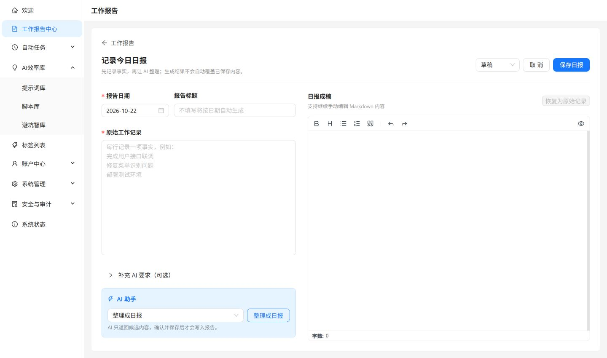

这条入门路径不要求一次配置所有功能。先完成记录与复用，再决定哪些工作值得自动化。

## 1. 登录工作台

打开 [WDM 工作台](https://www.aiwdm.cn)并使用账号登录。系统同时支持密码与 Passkey；你能看到的菜单和功能由账号所属用户组决定。

:::note
如果缺少某个菜单，请先确认账号权限，而不是重复刷新页面。
:::

报告整理、提示词优化、脚本分析和 AI 自动任务需要管理员提前配置外部 Hermes-Agent。即使 AI 服务暂时不可用，你仍可以继续记录报告和管理已有资产。

## 2. 保存第一篇日报

进入工作报告，选择日报和日期，写下当天完成事项、问题与下一步。需要时使用 AI 整理或润色，检查候选内容后再保存。

_左侧写事实，右侧检查成稿；点击保存才写入记录。截图来自空白表单，没有真实业务内容。_

**完成检查：** 返回列表后能够找到对应日期的日报。如果本日已有记录，先打开原记录，避免误覆盖。目标周的日报积累后，才适合[生成周报](../guides/reports/#生成周报)。

## 3. 沉淀一个常用方法

把经常重复输入的任务说明保存到提示词库，或把稳定的处理逻辑保存到脚本库。为它添加清晰的分类和标签，方便以后查找。

- [提示词](../guides/prompts/)：把变化的材料写成 `{{变量名}}`，使用时填写、预览和复制。
- [脚本](../guides/scripts/)：先写清 JSON 输入和输出，再测试代码。
- [避坑经验](../guides/pitfalls/)：记录已确认的问题和方案，尚未验证的判断标为假设。

**完成检查：** 下次需要时，可以通过分类、关键词或标签找到它。接收他人的内容请使用[分享码导入](../guides/sharing/)。

## 4. 先测试，再自动化

提示词先手动确认输出质量；可执行脚本先使用在线测试检查输入与输出。验证稳定后，再创建一次、周期、间隔或 Webhook 自动任务。

## 5. 检查结果

自动任务运行后，在执行日志中检查状态与输出。需要主动提醒时，可先在账户中心配置邮件或 Bark 渠道，再绑定到任务。

**完成检查：** 执行结果正确且通知送达。如果执行成功但通知失败，单独检查渠道，避免重复运行任务。

## 6. 留存一个恢复点

在调整大量提示词、脚本或任务前，进入[数据备份](../guides/backup/)创建本人业务快照。等待成功再下载保存。导入 ZIP 只加入备份列表，覆盖还原会替换当前数据，不要把两者混用。

## 推荐阅读顺序

1. [功能总览](../overview/)
2. [工作报告](../guides/reports/)
3. [提示词库](../guides/prompts/)或[脚本库](../guides/scripts/)
4. [自动任务](../guides/automation/)
5. [AI 与脚本安全](../reference/ai-and-script-safety/)
