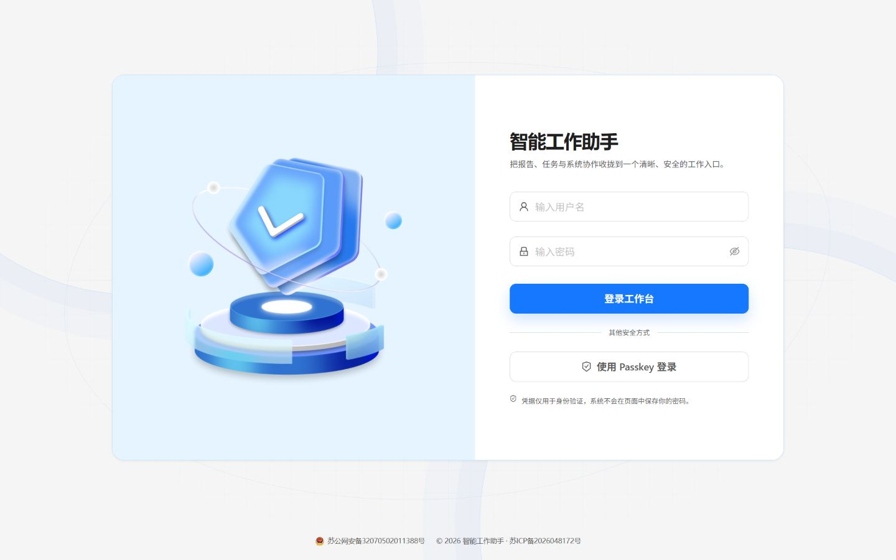

## 登录方式

WDM 支持密码和 Passkey 登录。连续多次密码登录失败会触发临时锁定；具体失败次数和锁定时长由系统管理员配置。

_使用自己的账号登录，或选择已经注册的 Passkey。此图没有填入任何账号和密码。_

Passkey 凭据属于当前账号。注册、重命名和删除凭据都需要当前身份验证；Passkey 是否可用还取决于部署域名与浏览器环境。

## 菜单与权限

账号属于一个用户组，用户组决定可见菜单和可用功能。菜单不可见或操作被拒绝时，请联系管理员检查用户组与功能权限。

前端是否显示按钮不是最终安全判断，系统仍会在服务端验证每次敏感操作。

## 保护账号与数据

- 不要向他人发送访问令牌、密码、Webhook 密钥或渠道凭据。
- 不要把敏感数据写入提示词、脚本、测试参数或自动任务说明。
- 使用分享码导入脚本后先检查源码，再进行在线测试。
- 修改密码、删除 Passkey 或调整敏感配置后，确认账号仍可正常登录。

## 审计范围

系统会记录成功登录、退出和部分受审计写操作。登录日志当前不等同于完整的失败登录记录，也不能用于撤销业务操作。

## 第一次登录后

1. 进入“账户中心 → 个人中心”，检查本人资料是否准确。
2. 在“安全设置”中管理本人 Passkey；先确认设备和浏览器支持，再按系统提示完成注册。
3. 核对可用菜单。缺少提示词、备份或避坑智库入口时，请管理员检查对应权限。
4. 需要定时提醒时配置[通知渠道](../notifications/)，需要恢复点时创建[数据备份](../backup/)。

上传头像支持 PNG、JPEG、WebP，文件不超过 2 MB、最长边不超过 4096 像素。预览时可拖动和缩放裁切范围，确认后更新，取消不会更改已保存头像。

## 两类权限不要混淆

**功能权限**决定能否进入某个模块；**数据归属**决定能操作哪些记录。管理员拥有功能管理权限，也不能因此随意读取其他账号的私有报告、提示词、脚本和经验。

收到分享码时仍需登录并拥有对应功能权限。分享副本与[私有备份](../backup/)的账号校验也不能绕过这一边界。
