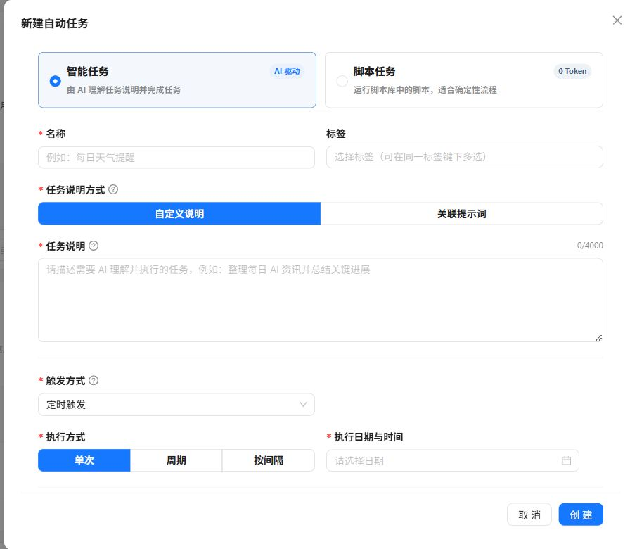

自动任务适合输入明确、结果可检查、已经手动验证过的重复工作。任务可以执行 AI 指令或当前账号的私有脚本。

## 创建前准备

进入 **自动任务 → 任务管理**。先确认自己能说明三件事：输入从哪里来、运行后应得到什么、怎样判定失败。需要接收结果时，先设置并测试[通知渠道](../notifications/)。

| 要处理的工作 | 优先选择 | 准备内容 |
| --- | --- | --- |
| 整理文字、生成摘要 | 智能任务 | 明确的任务说明或启用提示词 |
| 固定规则的数据处理 | 脚本任务 | 本人的启用脚本及合法 JSON 参数 |
| 响应外部系统事件 | Webhook 触发 | 可验签的服务端调用方与 JSON 载荷 |

## 选择执行内容

### AI 任务

AI 任务由外部 Hermes-Agent 执行。填写自定义任务说明，或关联一个当前账号已启用的提示词，两者选择一种。关联提示词时，任务每次运行都会读取最新正文。

每次请求按独立上下文提交，不会自动附带先前对话。AI 任务可以关联一个上游任务，读取其最近一次完成输出作为参考；不能自关联或形成循环依赖。外部 AI 服务的实际上下文隔离能力取决于服务配置。

_线上版本的空白表单。不同版本可能使用弹窗或页内布局；先配置执行内容，再设置触发计划和通知渠道。配图只保留表单区域。_

### 脚本任务

选择当前账号拥有、已启用且语言为 Python、JavaScript 或 Shell 的私有脚本。任务每次运行都会读取脚本库中的最新源码。

## 选择触发方式

在创建表单中依次填写名称、执行内容、触发方式、计划、通知渠道，检查后再创建。首次运行优先选择单次计划，便于检查结果。高级关联与可选字段以当前版本表单为准。

| 触发方式 | 必要配置 | 适合场景 |
| --- | --- | --- |
| 一次 | 指定执行时间 | 只执行一次的提醒或处理 |
| 周期 | 每日、每周或每月及执行时间 | 固定日历计划 |
| 间隔 | 分钟或小时间隔 | 按固定频率重复 |
| Webhook | 接入地址、签名密钥与 JSON 请求 | 由外部系统事件触发 |

每周任务至少选择一个星期；每月任务选择 1–31 日。请留意某些月份不存在 29、30 或 31 日。

如果要求每月都运行，优先选每个月都存在的日期。配置后核对页面展示的下一次执行时间，不要只凭计划文字推断时间。

## Webhook 数据如何进入任务

- AI 任务会把 JSON 载荷作为不可信参考材料附加到任务说明中。
- 脚本任务未配置固定参数时，JSON 对象会原样写入标准输入。
- 脚本任务已配置参数时，Webhook 数据会放入保留的 `trigger` 字段，不能被自定义参数覆盖。

对接方需要按页面示例发送时间戳和签名；可选事件 ID 用于避免同一事件重复执行。密钥只应保存在受保护的服务端配置中。

接入时使用页面提供的地址、签名方法及调用示例。请求包含 `X-Webhook-Timestamp`、`X-Webhook-Signature`，可选 `X-Webhook-Event-Id`；签名必须针对原始请求体。收到接收响应后还要检查执行日志，接收成功不代表任务已执行完成。密钥轮换后同步更新调用方。

不要在公开截图或文档中展示真实接入地址和密钥。上游输出仅作为材料读取，不会自动触发下游任务，也不改变下游自己的计划。

## 运行、暂停与检查

- `运行中`任务参与计划同步或接收 Webhook；`已暂停`任务不会执行。
- 单次任务成功完成后会自动暂停。
- 执行日志统一记录定时、手动测试和 Webhook 执行历史。
- Webhook 请求日志单独展示接收、拒绝和幂等状态。
- 可绑定一个已启用的通知渠道发送运行结果。

## 执行日志与通知分开检查

进入 **自动任务 → 执行日志**，按任务和时间检查状态、输出及错误。接入 Webhook 时再看 **Webhook 请求**，区分验签拒绝、重复事件和已接收请求。

| 现象 | 排查顺序 |
| --- | --- |
| 到时间没有结果 | 任务是否暂停 → 下一次时间 → 后台执行服务 |
| AI 失败 | 说明是否完整 → 关联提示词是否启用 → AI 服务连接 |
| 脚本失败 | 本人归属与启用状态 → 语言 → JSON 参数 → 执行服务 |
| 执行成功但没收到提醒 | 渠道启用状态 → 测试发送 → 通知失败信息 |
| Webhook 被拒绝 | 原始请求体、时间戳、签名和事件 ID |

重试前确认上次是否已产生外部副作用，避免重复发送消息或重复修改数据。

:::caution
提示词、脚本、上游任务和通知渠道都在执行时读取最新配置。修改其中任何一项都可能改变下一次运行结果。对会发送消息或修改外部数据的任务，修改后应再次手动测试。
:::
