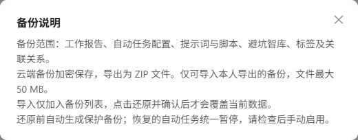

进入 **账户中心 → 数据备份**，为本人业务数据创建快照并导出 ZIP。适合集中修改前留存恢复点。下载的 ZIP 包含明文业务数据，应妥善保管。

_配图只保留说明弹窗，不展示账号标识、已有备份或下载地址。_

## 范围与排除项

| 会备份 | 不会备份 |
| --- | --- |
| 日报、周报 | 账号资料、密码、Passkey、登录凭证 |
| 提示词、变量默认值及分类 | 通知渠道与其中的凭据 |
| 脚本、源码及分类 | 系统配置、Webhook 密钥 |
| 避坑经验的完整 Markdown | 分享码、领取关系、AI 分析缓存 |
| 自动任务配置、标签及相关绑定 | 执行和请求日志、任务最近结果 |

已经通过分享码保存的副本属于本人数据，会随对应模块一起备份。

## 创建并下载

1. 点击“一键备份”，为当前本人数据创建快照。
2. 等待排队、处理中状态变为成功，关闭页面不会取消已入队任务。
3. 下载 ZIP，记录**数据快照时间**，存放到受保护的位置。
4. 保留原始文件，不修改内容再重新打包导入。

长期排队时联系管理员检查后台处理；失败时先查看错误，再检查存储配置或数据关联，不要连续重复创建。

## 导入不等于还原

导入只把校验通过的文件加入备份列表，不立即改动业务数据。只支持**当前系统、当前账号导出的未修改文件**，不能用于跨账号迁移或分享。

系统检查格式、完整性、签名和归属。升级后格式不兼容时，应重新创建备份，不要手工改清单绕过校验。ZIP 最大 50 MB，解压后最大 200 MB，总记录数最大 100000。

## 覆盖还原

:::danger[会替换现有数据]
还原会覆盖备份范围内的当前数据，备份后新增的记录会被删除。它不是追加导入或单条恢复。先核对账号、快照时间和范围，再明确确认。
:::

1. 停止编辑相关数据，等待正在运行的任务和备份操作结束。
2. 选中备份，阅读并确认覆盖提示。
3. 系统先为当前数据生成保护备份，保护失败则停止还原。
4. 等待还原成功，再打开业务页面检查数据。

同一账号不能并行备份和还原。缺少所涉业务功能权限时，还原会被拒绝。

## 还原后逐项检查

- 所有自动任务恢复为**暂停**，检查配置后逐一启用；错过的定时任务不会补跑。
- Webhook 地址与密钥重新生成，须更新外部调用方。
- 通知渠道不在备份中，关联丢失时重新选择并测试。
- 业务关联会重建，外部保存的旧业务 ID 不会自动重定向。
- 原记录的旧分享码失效，其他账号已领取的副本保留。

删除云端备份前核对是否仍需保留。系统升级或配置密钥变更可能影响旧文件可用性，校验、解密失败时联系管理员。
