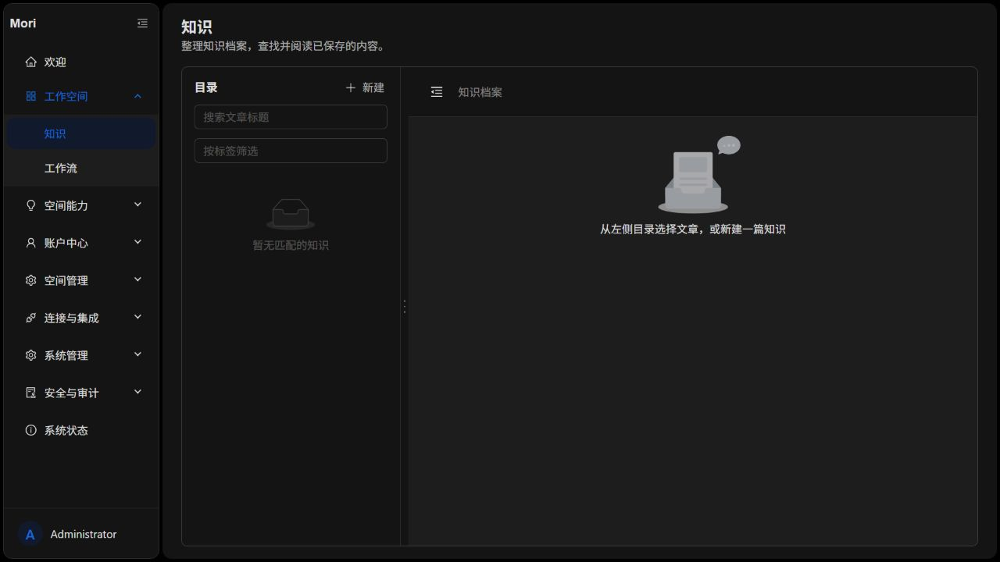

知识档案用于保存当前账号的工作知识。你可以按目录整理文章，用标题、类型、摘要、适用场景、来源和标签说明资料，再单独编辑 Markdown 正文。

## 创建与发布

1. 进入 **工作空间 → 知识**。从目录上方的 **新建** 菜单创建目录，或选择已有目录。目录只有一层，每篇文章属于一个目录。
2. 选择 **新建 → 新建知识**，填写文章资料。文章先保存为**草稿**，正文在阅读区域单独编辑和保存。
3. 检查预览和资料后发布。发布需要正文非空，已发布文章可以继续编辑，也可以撤回为草稿。

正文支持 Markdown 预览，可上传 JPEG、PNG 或 WebP 图片。上传的图片需要使用当前账号登录后才能查看。

## 在工作台查找文章

在左侧目录输入文章标题的一部分，或选择标签。选择多个标签时，文章需同时匹配全部标签。目录树会随筛选条件更新。

## 引用已有资产

在正文行首或空白后输入 `@`，可以搜索并插入本人的避坑经验、提示词或脚本。预览时点击引用可查看来源状态，并跳转到原资产。来源更新时会出现提示，来源不可用时会保留引用标题。

## 导出 Markdown

从文章操作栏导出已保存的 Markdown 正文。文件只包含正文，资产引用会转成普通说明。

## 让 Agent 查询

在 [MCP 授权](../expert-mcp/)中选择知识读取权限后，Agent 可以查询并读取**本人已发布**的文章。

- 可以用空格分隔多个关键词，例如“部署 回滚”。标题、摘要、适用场景或正文命中任意一个词，即可进入结果。
- 可以加上标签缩小范围。结果按相关程度排序。关键词在正文中出现时，结果会附上命中片段，方便判断是否需要打开全文。
- 如果查不到，先确认文章已发布，再试试正文中实际出现过的词。

知识的创建草稿、编辑草稿和删除需要分别授权。客户端删除前须读取目标和版本，说明影响，并取得你对本次删除的明确确认。MCP 创建的文章保持草稿状态，检查后可在工作台发布。
