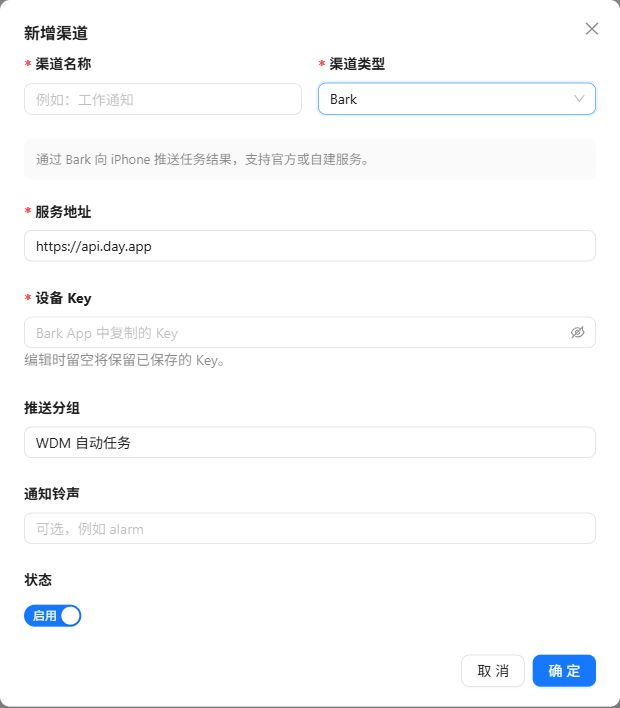
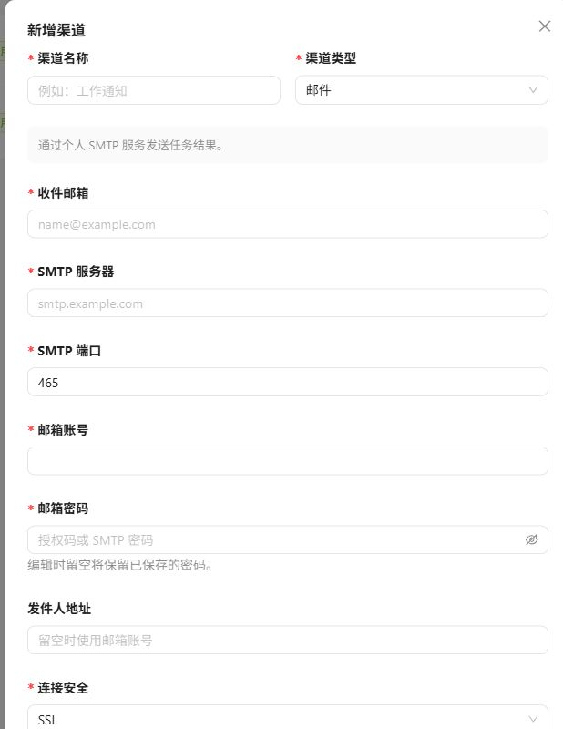

通知渠道在“账户中心 → 渠道管理”中维护。每个渠道只属于当前用户，同一用户内渠道名称不能重复。

## 支持的渠道

### 邮件

填写收件地址和 SMTP 连接配置。根据邮件服务商选择 SSL、STARTTLS 或无加密连接；生产环境优先使用加密连接。

| 字段 | 填写依据 |
| --- | --- |
| 渠道名称 | 容易区分用途的名称，本人账号内唯一 |
| 收件邮箱 | 实际接收任务结果的邮箱 |
| SMTP 服务器与端口 | 邮件服务商提供的发信参数 |
| 邮箱账号与密码 | 发信账号及服务商要求的 SMTP 密码或授权码 |
| 发件人地址 | 按服务商规则填写，不能随意冒用其他地址 |
| 连接安全 | 与服务器和端口匹配的 SSL 或 STARTTLS |

### Bark

填写 Bark 官方或自建服务地址、设备 Key、分组和可选铃声。发送时通过 Bark 的 `/push` 接口投递。

_从 Bark 客户端获取自己的设备 Key，不要把 Key 拼进公开链接、截图或任务正文。图中仅保留默认地址和空白字段。_

## 配置流程

1. 新建渠道并选择类型。
2. 按动态表单填写配置。
3. 保存后先执行测试发送。
4. 测试成功后，在自动任务中绑定该渠道。

_邮件渠道需要使用邮件服务商提供的 SMTP 参数；密码栏通常填写授权码，而不是网页登录密码。_

此图展示邮件表单的主要字段，连接安全与状态位于表单下方。保存后执行测试发送；测试会向配置的接收端实际投递，请确认接收对象。

## 与自动任务绑定

在任务表单选择本人已启用渠道，任务运行时按最新配置投递，不会复制 SMTP 或 Bark 设置。要换收件人，先修改渠道并测试，再检查所有引用它的任务是否都应该使用新地址。

执行失败和通知失败是两个问题。任务已有正确输出但没有提醒时，先测试渠道，不必反复重跑可能产生副作用的任务。

## 注意事项

- 密码、设备 Key 等敏感字段不会在查询时返回原值；编辑时留空会保留已有值。
- 自动任务只能新绑定已启用的渠道。
- 任务运行时读取渠道最新配置，因此修改后无需重新绑定。
- 已被自动任务引用的渠道不能删除，请先解除任务绑定。
- 渠道在执行时不存在或已停用，任务仍可能完成，但通知会记录为失败。
