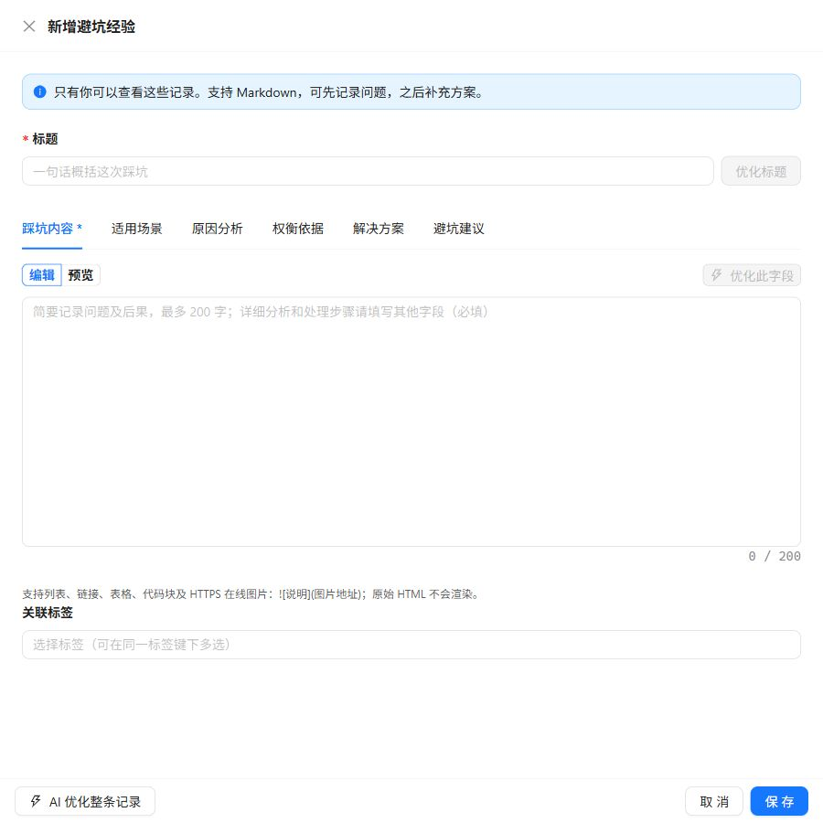

进入 **AI效率库 → 避坑智库**，把一次排错留下的结论保存成下次能用的经验。记录只对本人可见，可以先记问题，再逐步补全原因与方案。

## 新增一条经验

1. 点击“新增经验”，用标题概括现象与关键结论。
2. 在“踩坑内容”写清问题、影响和已确认的现象。
3. 切换到适用场景、原因分析、权衡依据、解决方案和避坑建议，补充细节。
4. 预览排版，添加标签后保存。



_配图只保留空白编辑抽屉，排除背景中原有经验。切换字段可继续填写当前草稿。_

## 每个字段写什么

| 字段 | 建议记录 |
| --- | --- |
| 标题 | 一句话概括问题，最多 200 字符 |
| 踩坑内容 | 简短记录现象与后果，最多 200 字符 |
| 适用场景 | 环境、版本、前置条件和不适用情况 |
| 原因分析 | 已验证原因与证据，假设应明确标注 |
| 权衡依据 | 为什么选此方案，代价及替代方案 |
| 解决方案 | 可复现的处理步骤及成功判定 |
| 避坑建议 | 下次如何预防，何时重新验证 |

只有标题和踩坑内容必填，其余五个正文字段各最多 20000 字符。详细命令与分析放入对应字段，避免把全部材料塞入摘要。

## Markdown 与图片

正文支持列表、链接、表格、代码块和 HTTPS 在线图片：

```md

```

图片须使用不含用户名、密码的绝对 HTTPS 地址。原始 HTML 不会渲染；导出只保留图片链接，不下载或内嵌文件。图片由外部地址加载，失效后不能保证继续显示。

:::caution[配图前先脱敏]
移除邮箱、IP、客户资料、访问令牌和内部地址。不要在图片 URL 中加入临时凭据。
:::

## AI 优化与采纳

可以优化当前字段，或整条记录中已填写的字段。AI 返回候选内容、改进说明和待补充问题，供逐字段比较；不会自动替你补全空白字段。

采纳只改变当前表单，仍需点击保存。优化期间若继续修改某字段，采纳前检查覆盖提示。失败时保留原稿再重试；候选内容不等于已验证结论。

## 找回、导出与分享

- 关键词检索全部内容字段，多标签使用 AND 筛选。
- 卡片摘要只展示部分文字，详情可查看完整记录。
- Markdown 导出包含完整标题、正文和时间，不包含个人标签。
- 使用[分享码](../sharing/)交给其他账号，领取后双方修改互不影响。

看不到入口时联系管理员确认功能权限；管理权限不会自动开放其他账号的记录。
