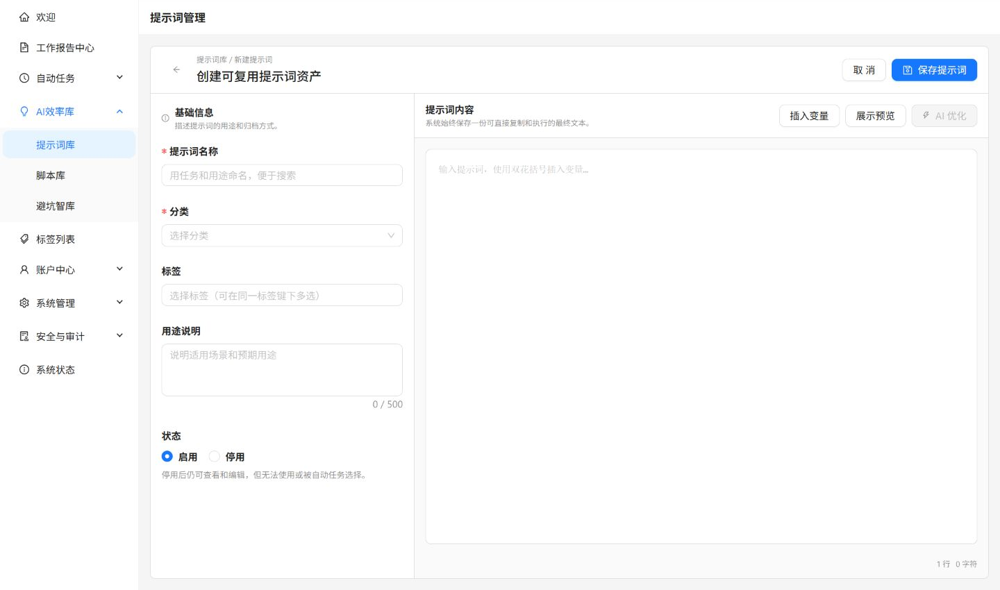

提示词库用于保存已经验证有效的 AI 指令。提示词只对创建者本人可见，没有公共发布能力。

## 创建提示词

1. 填写名称、说明和正文。
2. 在文本正文中按需插入 `{{变量名}}`，并设置变量默认值。
3. 选择单层分类，并按需添加多个标签。
4. 保存后测试实际效果，再决定是否用于自动任务。



_名称、分类和用途用于后续检索；真正会被复制或执行的是右侧保存的最终正文。_

当前统一使用文本正文与变量，旧版结构化主题和编辑模式已移除。

## 用变量准备本次材料

例如，把经常复用的会议整理指令写成：

```text
请将以下会议记录整理为行动清单。
每项包含事项、负责人、截止时间。
没有提供的信息标为“待确认”，不要推测。

会议记录：{{会议记录}}
输出语言：{{输出语言}}
```

点击“插入变量”添加占位符，为“输出语言”设置“简体中文”等默认值。同名变量在使用时共用一个输入框。

1. 找到已启用提示词，打开使用流程。
2. 有变量时填写本次材料，检查替换后的预览。
3. 复制最终正文，到目标 AI 工具中使用，再完成流程。

无变量时直接进入预览复制。变量留空时使用默认值；没有默认值则保留占位符，复制前检查是否仍有未填写的 `{{变量名}}`。

## 从草稿到 AI 优化

先写清任务、材料、输出格式和约束，再请求 AI 优化。优化可以处理尚未保存的正文；返回候选内容后检查是否保留原意、变量和格式，确认后再保存。失败时保留原稿，澄清输入后重试。

## 日常管理

- 使用搜索、分类和标签找到目标提示词。
- 启用的提示词排在停用提示词之前。
- 只有启用的提示词可以复制或供自动任务选择。
- 分类名称在你的账号内不能重复；包含提示词的分类不能直接删除。
- AI 优化可以处理尚未保存的正文，结果返回后仍需由你确认。

## 注意事项

提示词用于自动任务时，每次执行都会读取提示词库中的最新正文。修改已关联的提示词会影响后续运行，建议修改后重新测试。

自动任务不会弹出变量填写窗口，关联前应确认保存的正文和任务输入已经足够完整，避免留下必须人工填写的占位符。需要交给其他账号时，使用[分享码](../sharing/)，对方领取后保存为独立私有副本。
