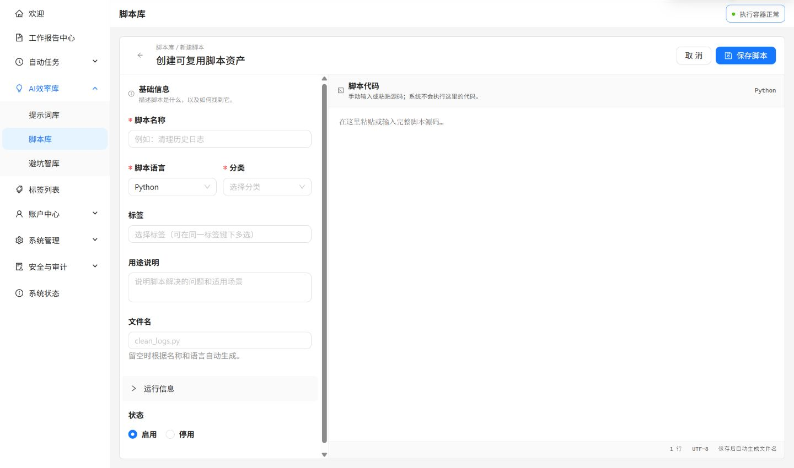

脚本库可以保存 Python、JavaScript、Shell、PowerShell、SQL 和其他语言的源码，也会记录文件名、运行说明、参数说明、分类、标签与来源。

## 哪些脚本可以执行

| 语言 | 保存与查看 | 在线测试与自动任务 |
| --- | --- | --- |
| Python | 支持 | 支持 |
| JavaScript | 支持 | 支持 |
| Shell | 支持 | 支持 |
| PowerShell、SQL、Other | 支持 | 不支持 |

可执行脚本必须处于启用状态。在线测试会把 JSON 参数写入标准输入，并返回标准输出和执行耗时。

## 建议操作流程

1. 写清脚本名称、用途、输入参数和输出格式。
2. 使用代表性的 JSON 参数执行在线测试。
3. 检查空输入、错误输入和失败信息。
4. 需要时使用 AI 解释或安全分析辅助审查。
5. 验证稳定后，再关联到自动任务。



_先填写语言、分类和用途，再在右侧粘贴源码；保存并不等于执行，后续仍需单独运行测试。_

## 用 JSON 参数测试一个简单脚本

在线测试将 JSON 写入标准输入，脚本通过标准输出返回结果，不会自动把 JSON 变成命令行参数。例如以下 Python 示例不访问网络和业务文件：

```python
import json
import sys

params = json.load(sys.stdin)
name = params.get("name", "朋友")
print(f"你好，{name}！")
```

测试参数填写 `{"name": "示例用户"}`，预期输出为 `你好，示例用户！`。再检查空对象和错误输入，确保失败信息可理解。保存源码本身不会执行代码。

## 私有脚本与分享导入

脚本与分类统一归本人私有，不再提供公共发布。自动任务只能关联本人的启用脚本；其他账号提供的脚本须先通过[分享码导入](../sharing/)，审阅源码并测试后再关联。

导入不会执行脚本，也不继承原作者的分类、私有标签、使用统计和 AI 分析缓存。复制、下载和执行分别记录次数。

## 执行失败时检查

| 现象 | 先检查什么 |
| --- | --- |
| 不能选择执行 | 是否启用，语言是否为 Python、JavaScript 或 Shell |
| 读取参数失败 | 参数是否为合法 JSON，源码是否读取标准输入 |
| 容器不可用 | 执行服务状态，联系管理员检查服务连接 |
| 超时或输出超限 | 缩小输入，检查循环和输出量，不重复盲目运行 |

AI 解释和安全分析是静态参考，可能返回已有分析结果。关联自动任务后，每次执行都会读取最新源码，因此修改脚本后应重新测试。

:::caution
不要在源码或测试参数中写入密码、Token 或密钥。AI 安全分析只提供静态参考，不能替代测试、权限控制或隔离执行。
:::
