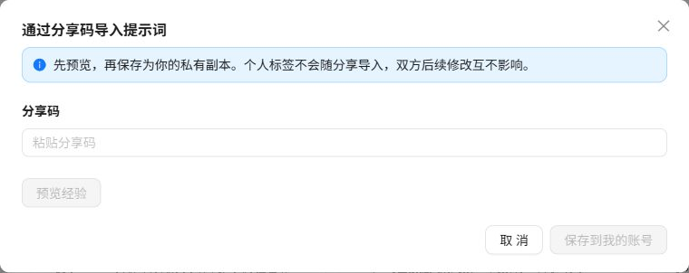

提示词、脚本和避坑经验均支持站内分享码。分享只传递生成时的**内容快照**，不会开放原记录的查看或编辑权限。

## 生成分享码

1. 在资产操作菜单选择“分享”。
2. 检查快照，移除源码凭据、个人信息和内部地址。
3. 设置有效期及最多领取次数，生成分享码。
4. 复制并通过认可的私密渠道交给接收人。

有效期为 1～30 天，界面提供 1、7、30 天，默认 7 天；最多领取次数为 1～1000，默认 1 次。明文代码仅创建时返回，遗失后应撤销并重新生成。

## 接收并导入

1. 登录接收账号，进入对应业务页面。
2. 点击“分享码导入”，粘贴收到的代码。
3. 预览完整快照，确认适合保存和使用。
4. 确认导入，提示词和脚本进入本人“分享导入”分类，经验保存为本人记录。
5. 添加自己的分类和标签；导入脚本先审阅、测试，再运行。

_先预览，再确认。配图不包含任何有效分享码。_

预览不消耗次数。双方均须登录并拥有对应功能权限；不能领取自己生成的分享。

## 会带来哪些内容

| 类型 | 包含 | 不包含 |
| --- | --- | --- |
| 提示词 | 名称、说明、正文、变量默认值和状态 | 原分类、个人标签、统计 |
| 脚本 | 源码、语言、文件名、用途与运行参数说明等 | 原分类、标签、统计、AI 缓存 |
| 避坑经验 | 标题与六个 Markdown 字段 | 标签、用户信息、源记录时间 |

外链图片保留原地址，不复制图片文件。导入不会自动执行脚本。

## 更新、撤销与重复领取

- 修改原记录不改变已经生成的快照，分享新版需重新生成代码。
- 新代码不会覆盖对方已领取的旧副本。
- 同一账号领取同一码只生成一份副本，重复领取不再消耗次数。
- 删除已领取副本后，不能用同一码重新领取。
- 撤销、到期、额度用完、原记录或分享人账号删除后不能再领取；已领取副本保留。
- 预览与领取共用频率限制，连续失败时按页面提示等待，不要反复试码。

:::caution
分享码应按临时访问凭证保管，不放入公开文档、截图或 URL。误发后及时撤销；撤销不能收回对方已经保存的副本。
:::
