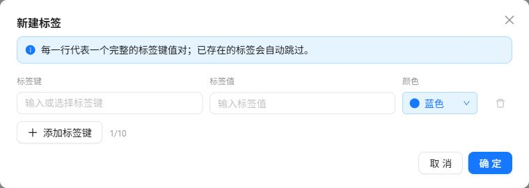

标签由完整的 `键 + 值` 组成，例如 `场景 = 周报`、`用途 = 写作`。它们可以用于提示词、脚本、自动任务和避坑经验，但不会改变资源的访问权限。

## 创建并绑定

1. 进入“标签列表”，新增完整键值标签。
2. 选择预设颜色，保留清楚的文字含义。
3. 在资源编辑器的标签选择器中绑定本人已启用标签。
4. 保存资源，再到列表中使用标签筛选。

## 设计一套好用的标签

- 一个键只表达一个维度，例如“场景”“项目”“状态”。
- 值保持有限、稳定，避免同义词和随意缩写。
- 不要用标签重复名称、分类、启停状态等系统已有字段。
- 同一资源可以绑定同一键下的多个值。

_每一行代表一个完整的键值标签；颜色只帮助识别，不会影响筛选和权限。_

## 筛选规则

选择多个标签筛选时使用 AND 语义：资源必须同时满足所有已选标签，才会出现在结果中。

例如选中 `场景 = 周报` 和 `用途 = 写作`，只显示同时绑定两者的资源。结果为空时先去掉一个标签，不要把它理解成“满足任意一个”。

## 启用、停用与删除

- 停用标签后，不能再建立新的绑定，但已有绑定仍会显示。
- 已被资源引用的标签不能删除；先从相关资源解除绑定。
- 标签只属于当前用户，分享码导入不会继承分享人的标签，接收后自行绑定。

异常关联巡检只处理本人标签的异常关系，不会删除业务内容。资源删除后对应绑定会清理，标签本身仍可继续使用。
