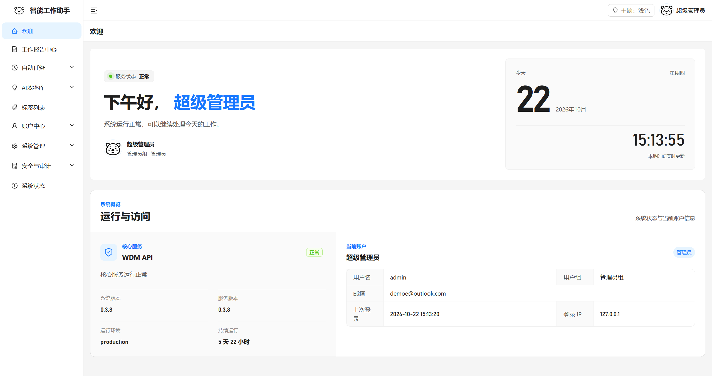

import { CardGrid, LinkCard } from '@astrojs/starlight/components';

01 / 从这里开始按目标找到下一步

## 今天，先完成一件事

<CardGrid>
  <LinkCard title="第一次使用" description="登录、保存第一篇日报，再尝试方法复用。" href="./getting-started/" />
  <LinkCard title="配置一次自动任务" description="选择 AI 或脚本、触发计划和通知渠道，检查执行结果。" href="./guides/automation/" />
  <LinkCard title="接收分享的内容" description="预览分享码快照，保存成自己的提示词、脚本或经验。" href="./guides/sharing/" />
  <LinkCard title="备份与恢复数据" description="了解备份范围、文件导入与覆盖还原。" href="./guides/backup/" />
</CardGrid>

02 / 使用指南从记录，到执行

## 让方法进入日常

  <section>01<h3>记录与复盘</h3>
记下事实，留下已经验证的方法。
<a href="./guides/reports/">写日报与汇总周报 ↗</a><a href="./guides/pitfalls/">保存一条避坑经验 ↗</a><a href="./guides/tags/">用标签整理内容 ↗</a></section>
  <section>02<h3>沉淀与复用</h3>
把反复使用的指令和代码收好。
<a href="./guides/prompts/">创建带变量的提示词 ↗</a><a href="./guides/scripts/">保存与测试脚本 ↗</a><a href="./guides/sharing/">分享与导入内容副本 ↗</a></section>
  <section>03<h3>执行与检查</h3>
按计划运行，把结果送到手边。
<a href="./guides/automation/">配置自动任务 ↗</a><a href="./guides/notifications/">接收邮件或 Bark 通知 ↗</a><a href="./guides/backup/">备份与恢复本人数据 ↗</a></section>

03 / 产品界面熟悉你的工作入口

## 先认识工作台

_工作台概览图为 2560×1356；教程图按 1440×900 桌面视口采集，表单仅做局部裁切。点击可放大查看，界面状态仅代表采集当时。_

<h3>遇到问题，先从这里查。</h3>
了解 AI 候选、私有资产、分享与覆盖还原的边界。

<a href="./reference/faq/">常见问题 ↗</a><a href="./reference/ai-and-script-safety/">安全须知 ↗</a>

